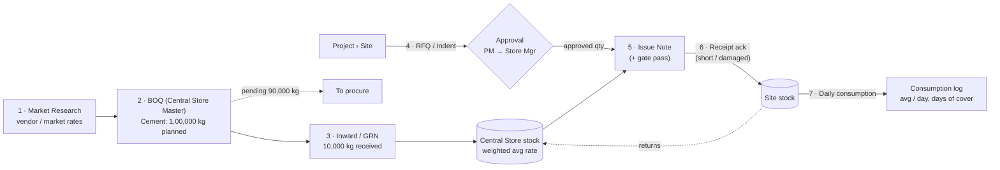

# BOQ Management System: Implementation Plan

> **Status:** Draft plan, awaiting "go"
> **Stack:** React (Vite + TS) · FastAPI · PostgreSQL · Redis
> **Clients:** Responsive web now, Flutter mobile app later (same `/api/v1`)
> **Date:** 2026-10-09

---

## 1. What we're building

This is a material control system for a real-estate developer running several projects, each with one or more sites.

Reading of the handwritten sketch:

| Sketch element | Meaning in the system |
|---|---|
| **(1) Market Research** | Step 1. Collect vendor and market rates per material. These rates feed the BOQ's estimated rates. |
| **BOQ: Bill of Quantity → Store** | **Central Store Master.** Management plans how much of each material is needed (e.g. *Cement, 1,00,000 kg*), with an estimated rate and value. |
| **10,000 → inward** | Goods Receipt (GRN). Material physically received into the central store against the BOQ. |
| **90,000** | **Pending to procure** = Planned − Inward (1,00,000 − 10,000). |
| **Issue note → circles** | Sites (grouped under projects) raise an **RFQ / indent**. Once approved, the store sends material with an **Issue Note**. |
| **Day** (inside site circle) | Each site records daily material consumption. |
| **Avg** | (a) Material is issued at its **weighted average rate**. (b) Each site's **average daily consumption** is tracked. |
| **(AU)** | Read as **Audit/Approval**: maker-checker approvals plus a full audit trail. *(Open question Q8 asks you to confirm this.)* |

### End-to-end flow



### Worked example (used for tests too)

| Step | Event | Central stock | BOQ pending-to-procure | Site A stock |
|---|---|---|---|---|
| 1 | BOQ approved: Cement 1,00,000 kg @ ₹7.00 est. | 0 | 1,00,000 | 0 |
| 2 | GRN-1: 10,000 kg @ ₹6.80 | 10,000 (avg ₹6.80) | 90,000 | 0 |
| 3 | GRN-2: 5,000 kg @ ₹7.10 | 15,000 (avg ₹6.90) | 85,000 | 0 |
| 4 | Site A RFQ 3,000 kg → PM approves 3,000 → Issue Note 3,000 @ ₹6.90 | 12,000 | 85,000 | 3,000 (in transit) |
| 5 | Site A acknowledges 2,950 received, 50 damaged | 12,000 | 85,000 | 2,950 |
| 6 | Site A consumes avg 500 kg/day | — | — | days of cover ≈ 5.9 |

---

## 2. Modules

| # | Module | Purpose |
|---|---|---|
| M0 | **Auth & Admin** | Login, JWT access + refresh tokens, users, roles, permission matrix, scoped assignments, audit log viewer |
| M1 | **Masters** | Material categories, UOM (+ conversions, e.g. 1 bag = 50 kg), materials, vendors, projects, sites, stores; CSV bulk import |
| M2 | **Market Research** | Vendor quotes and market survey rates per material, rate history, vendor comparison, benchmark (min/avg/last) |
| M3 | **BOQ (Central Store Master)** | Planned qty, estimated rate, and value per material. Optional allocation per project/site. Approval workflow. Revisions (Rev 0, Rev 1…) |
| M4 | **Inward / GRN** | Receive material from vendor against a BOQ line. Received / rejected / accepted qty, invoice and challan details, attachments. Posting updates stock |
| M5 | **RFQ / Material Request** | Site raises a request to the central store. Multi-level approval; approved qty can be less than requested |
| M6 | **Issue Note** | Store issues material against approved RFQ lines at weighted average rate. Gate pass PDF. Site acknowledges receipt (short or damaged) |
| M7 | **Site Operations** | Site stock, daily consumption entry (by activity), returns to central store |
| M8 | **Stock Engine** | Append-only stock ledger, running balances, weighted average costing, adjustments and physical stock audit |
| M9 | **Reports & Dashboards** | Role-level dashboards and reports (§7), Excel/PDF export |
| M10 | **Notifications** | In-app (and email) alerts for approvals pending, items issued, low stock |

**v1 out of scope** (Q3): Purchase Orders, vendor payments, and accounting/ERP integration. The GRN schema keeps a nullable `po_id` so POs can be added later without a migration of existing data.

---

## 3. Document lifecycles (state machines)

All documents use **maker-checker**: the user who creates a document can never approve it. Approved or posted documents are never edited or deleted. They are **cancelled**, and cancellation writes reversing stock ledger entries.

```
BOQ:          DRAFT → SUBMITTED → APPROVED → (REVISED → new version DRAFT; old = SUPERSEDED) → CLOSED
                         ↘ REJECTED (back to DRAFT with comments)

GRN:          DRAFT → POSTED (stock +) → CANCELLED (stock − reversal, only if stock allows)

RFQ:          DRAFT → SUBMITTED → PM_APPROVED → STORE_APPROVED → PARTIALLY_ISSUED → ISSUED → CLOSED
                         ↘ REJECTED / RETURNED_FOR_CHANGES        ↘ CANCELLED

Issue Note:   DRAFT → ISSUED (central −, in-transit +) → RECEIVED | PARTIALLY_RECEIVED (site +, shortage logged)
                                                       ↘ CANCELLED (reversal)

Adjustment:   DRAFT → SUBMITTED → APPROVED (stock ±) | REJECTED
```

Approval levels live in config (`approval_rules` table), so another level can be added later, e.g. Director approval above a value threshold.

---

## 4. Data model (PostgreSQL)

Conventions:
- PKs are `UUID` (safe for mobile and offline ID generation). `stock_ledger` and `audit_logs` use `BIGSERIAL`.
- Quantities are `NUMERIC(18,3)`, rates `NUMERIC(18,4)`, amounts `NUMERIC(18,2)`. **Never float.**
- Timestamps are `timestamptz` stored in UTC; document dates are `date` in IST.
- Every table has `created_at, created_by, updated_at, updated_by`. Master tables also have `is_active` (soft delete) and a `version` int for optimistic locking.
- `CHECK` constraints enforce `qty >= 0`, valid status values, and `accepted = received − rejected`.
- Document numbers come from a gap-free per-FY sequence: `BOQ/2026-27/0001`, `GRN/…`, `RFQ/…`, `ISN/…`, `ADJ/…`.

### 4.1 Auth & RBAC
| Table | Key columns |
|---|---|
| `users` | id, name, email (unique), phone, password_hash (argon2), is_active, failed_attempts, locked_until, last_login_at, must_change_password |
| `roles` | id, code, name, is_system |
| `permissions` | id, code (`boq.approve`), module, description |
| `role_permissions` | role_id, permission_id |
| `user_role_assignments` | user_id, role_id, **scope_type** (`GLOBAL`/`PROJECT`/`SITE`/`STORE`), scope_id |
| `user_sessions` | id, user_id, refresh_token_hash, device_name, platform (`web`/`android`/`ios`), ip, user_agent, expires_at, revoked_at, rotated_to |
| `audit_logs` | id, user_id, action, entity_type, entity_id, before (jsonb), after (jsonb), ip, user_agent, request_id, created_at |

### 4.2 Masters
| Table | Key columns |
|---|---|
| `material_categories` | id, code, name, parent_id |
| `uoms` | id, code (`KG`, `BAG`, `MT`, `CUM`, `NOS`), name |
| `uom_conversions` | material_id (nullable = global), from_uom_id, to_uom_id, factor |
| `materials` | id, code, name, category_id, base_uom_id, hsn_code, gst_rate, specification, reorder_level, is_active |
| `vendors` | id, code, name, gstin, pan, contact_person, phone, email, address, is_active |
| `projects` | id, code, name, city, address, start_date, end_date, status |
| `sites` | id, project_id, code, name, address, lat, lng, status |
| `stores` | id, code, name, **type** (`CENTRAL`/`SITE`/`IN_TRANSIT`), site_id (nullable) |

### 4.3 Transactions
| Table | Key columns |
|---|---|
| `market_rates` | id, material_id, vendor_id?, source (`VENDOR_QUOTE`/`MARKET_SURVEY`/`ONLINE`), rate, uom_id, quoted_on, valid_till, location, remarks |
| `boqs` | id, boq_no, title, financial_year, version, parent_boq_id, status, total_estimated_value, submitted_by/at, approved_by/at, remarks |
| `boq_items` | id, boq_id, material_id, planned_qty, uom_id, estimated_rate, estimated_amount, benchmark_rate (snapshot from M2) · `UNIQUE(boq_id, material_id)` |
| `boq_item_allocations` | id, boq_item_id, project_id, site_id?, allocated_qty |
| `grns` | id, grn_no, store_id, vendor_id, boq_id, po_id?, received_date, invoice_no, invoice_date, challan_no, vehicle_no, status, posted_by/at |
| `grn_items` | id, grn_id, boq_item_id, material_id, received_qty, rejected_qty, accepted_qty, rate, gst_rate, amount, rejection_reason |
| `material_requests` (RFQ) | id, request_no, project_id, site_id, store_id (central), required_by, priority, purpose, status |
| `material_request_items` | id, request_id, material_id, requested_qty, approved_qty, issued_qty (cached), remarks |
| `approvals` | id, entity_type, entity_id, level, action (`APPROVED`/`REJECTED`/`RETURNED`), actor_id, comment, acted_at |
| `issue_notes` | id, issue_no, request_id, from_store_id, to_store_id (site store), issue_date, vehicle_no, driver_name, driver_phone, status, received_by/at |
| `issue_note_items` | id, issue_note_id, request_item_id, material_id, issued_qty, rate, amount, received_qty, shortage_qty, damaged_qty |
| `consumption_entries` | id, site_id, store_id, entry_date, material_id, qty, activity (e.g. "Slab casting – Tower A L5"), remarks |
| `return_notes` / `return_note_items` | site → central return, same shape as issue note |
| `stock_adjustments` / `stock_adjustment_items` | adj_no, store_id, reason (`DAMAGE`/`WASTAGE`/`THEFT`/`PHYSICAL_COUNT`/`OPENING`), status · items: material_id, system_qty, physical_qty, delta_qty, rate |

### 4.4 Stock engine
| Table | Key columns |
|---|---|
| `stock_ledger` (**append-only**) | id, store_id, material_id, txn_date, txn_type (`OPENING`/`INWARD`/`ISSUE_OUT`/`TRANSIT_IN`/`TRANSIT_OUT`/`RECEIPT`/`CONSUMPTION`/`RETURN`/`ADJUSTMENT`/`REVERSAL`), ref_type, ref_id, ref_line_id, qty_in, qty_out, rate, value, balance_qty, balance_value, avg_rate_after |
| `stock_balances` | PK(store_id, material_id), qty, value, avg_rate, version, updated_at |
| `document_sequences` | doc_type, financial_year, next_value (row-locked) |
| `attachments` | id, entity_type, entity_id, storage_key, filename, mime, size, uploaded_by |
| `notifications` | id, user_id, type, title, body, entity_type, entity_id, read_at |
| `idempotency_keys` | key, user_id, endpoint, response_hash, created_at (TTL 24h) |

**Stock posting rules:**
1. Every stock-changing operation runs in **one DB transaction**. It locks the affected `stock_balances` rows with `SELECT … FOR UPDATE`, sorted by material_id to avoid deadlocks. It then appends ledger rows and updates balances.
2. A DB trigger blocks `UPDATE`/`DELETE` on `stock_ledger`.
3. A `CHECK (qty >= 0)` on `stock_balances` makes negative stock impossible even if the application has a bug.

---

## 5. Business formulas (single source of truth, mirrored in `boq-management/FORMULAS.md`)

| Metric | Formula |
|---|---|
| Accepted inward (BOQ line) | Σ `grn_items.accepted_qty` (posted GRNs) |
| **Pending to procure** | `planned_qty − accepted_inward` → *1,00,000 − 10,000 = 90,000* |
| Issued (BOQ line) | Σ issue_note_items.issued_qty (non-cancelled) for that material in the BOQ period |
| Balance to issue | `planned_qty − issued` |
| Central store stock | Σ inward + returns − issues ± adjustments |
| **Weighted avg rate** | `(cur_qty × cur_avg + in_qty × in_rate) / (cur_qty + in_qty)`. Issues go out at the current avg. |
| Stock value | `qty × avg_rate` |
| BOQ utilisation % | `issued / planned × 100` |
| Procurement progress % | `accepted_inward / planned × 100` |
| Rate variance % | `(actual_avg_GRN_rate − boq_estimated_rate) / boq_estimated_rate × 100` |
| Market benchmark gap % | `(actual_avg_GRN_rate − market_benchmark_rate) / market_benchmark_rate × 100` |
| Site avg daily consumption | `Σ consumption_qty in window / days in window` (default 7-day and 30-day) |
| Days of cover (site) | `site_stock / avg_daily_consumption` |
| Transit loss % | `(shortage + damaged) / issued × 100` |
| RFQ fulfilment % | `issued_qty / approved_qty × 100` |
| RFQ turnaround | `first_issue_at − submitted_at` (hours) |

**Validation rules** (each threshold configurable):
- GRN: cumulative accepted qty > planned qty × (1 + tolerance, default 5%) → **blocked** unless the BOQ is revised.
- RFQ: a project's cumulative requests exceeding its BOQ allocation → **warning**; a Store Manager override is required.
- Issue: issued qty ≤ `approved_qty − already_issued` **and** ≤ available central stock.
- Site receipt: received + shortage + damaged must equal issued.
- Consumption: cannot exceed site stock.

---

## 6. RBAC

### 6.1 Roles (seeded; admins can create more and edit the matrix in the UI)

| Role | Typical scope | Summary |
|---|---|---|
| **Super Admin** | Global | Users, roles, config, everything |
| **Management / Director** | Global | Approve BOQs and revisions, all dashboards and financials. Read-only on day-to-day transactions. |
| **Procurement Officer** | Global | Market research, vendors, draft BOQ rates |
| **Store Manager** | Store | Prepare/submit BOQ, post GRNs, store-approve RFQs, create issue notes, approve adjustments |
| **Store Keeper** | Store | Draft GRNs, issue notes, physical counts. **Cannot approve or post.** |
| **Project Manager** | Project(s) | Approve RFQs for their projects; project-level reports |
| **Site Engineer / Incharge** | Site(s) | Raise RFQs, acknowledge receipts, log consumption, returns. **Sees quantities only, no rates/values.** |
| **Auditor / Accounts** | Global | Read-only on everything incl. audit log, valuation, exports |

### 6.2 Permission matrix (abridged; `C`=create, `R`=read, `U`=update draft, `A`=approve/post, `X`=cancel, `E`=export)

| Module | Admin | Mgmt | Procure | Store Mgr | Store Kpr | PM | Site Eng | Auditor |
|---|---|---|---|---|---|---|---|---|
| Masters | CRUD | R | CRU (vendors) | R | R | R | R | R |
| Market research | CRUD | R | CRU | R | — | — | — | R |
| BOQ | all | R A | R U | C R U | R | R (own projects) | — | R |
| GRN | all | R | R | C R U A X | C R U | — | — | R |
| RFQ | all | R | — | R A X | R | R A (own) | C R U X (own) | R |
| Issue note | all | R | — | C R A X | C R U | R (own) | R + receive (own) | R |
| Consumption / returns | all | R | — | R A (returns) | R | R | C R U (own) | R |
| Adjustments | all | R | — | C R A | C R U | — | — | R |
| Reports: qty | all | all | all | store | store | project | site | all |
| Reports: ₹ value | all | all | all | store | — | project | **—** | all |
| Export | E | E | E | E | — | E | — | E |
| Users / roles / audit log | all | R audit | — | — | — | — | — | R audit |

### 6.3 Enforcement (defence in depth)
1. **Route level:** `Depends(require_perm("rfq.approve"))`. Reuses the analytics pattern, extended to `module.action` codes.
2. **Data scope level:** a `ScopeFilter` dependency resolves the user's allowed `project_ids` / `site_ids` / `store_ids` once per request. Every list or detail query goes through repository methods that **must** take the scope. A request for another site's record returns **404, not 403**, so record IDs can't be probed.
3. **Field level:** response schemas drop `rate`, `amount`, and `value` fields when the user lacks `finance.view`.
4. **Workflow level:** the service layer checks maker ≠ checker, the allowed state transition, and the approval level.
5. **UI:** `<Can perm="...">`, route guards, and role-aware navigation. These are convenience only; the API is the source of truth.
6. **Test level:** a parametrised pytest matrix runs every role against every endpoint, so permission regressions fail CI.

---

## 7. Reporting at each level

All reports take filters (date range, project, site, store, material, category) and export to Excel and PDF, gated by the `export` permission. Big lists are paginated server-side. Heavy aggregates use **materialized views** refreshed by a background job every 15 min and on demand after posting.

### Management (org level): dashboard + reports
- **BOQ vs Actual:** per material, Planned │ Inward │ Pending-to-procure │ Issued │ In-stock │ Utilisation %. *(The 1,00,000 / 10,000 / 90,000 view from the sketch, with progress bars.)*
- Budget vs actual value: estimated BOQ value vs procured value vs issued value.
- Rate variance: BOQ est. rate vs actual avg GRN rate vs market benchmark.
- Project-wise material cost and consumption (bar chart, drill-down to site).
- Stock valuation (weighted avg) by category.
- Top material-wise transit losses; RFQ turnaround SLA.

### Central Store level
- Stock summary (current qty, avg rate, value, reorder alerts).
- **Stock ledger** per material (opening → each txn → closing), i.e. a "bin card".
- Inward register (GRN register); vendor-wise inward.
- Issue register; pending RFQs to issue (queue with ageing).
- Non-moving / slow-moving stock (no movement in X days).
- Adjustment and physical-count variance register.

### Project level
- Project BOQ allocation vs requested vs issued vs consumed.
- Site-wise breakdown; project material cost to date.
- RFQ status summary (pending approval, approved, issued, rejected).

### Site level (mobile-first)
- My RFQs and their status; pending receipts (in transit).
- Site stock with **avg daily consumption** and **days of cover**.
- Daily consumption log and trend; transit shortages and damages.

### Market research
- Vendor rate comparison per material; rate trend chart; last/min/avg benchmark.

### Audit
- Audit trail (who changed what, before/after diff); cancelled documents; approval history per document.

### Printable documents (PDF)
- GRN, Issue Note with Gate Pass (QR code linking to the document for the site to scan on receipt), RFQ, and the BOQ summary.

---

## 8. API design (Flutter-ready)

- Base path is **`/api/v1`**. Breaking changes go to `/api/v2`.
- REST + JSON. **OpenAPI 3.1** is the contract:
  - `openapi-typescript` generates TS types for React.
  - `openapi-generator` (dart-dio) generates the Dart client for Flutter.
- **Response envelope** (consistent with the analytics app):
  `{ "success": true, "data": …, "meta": { "page", "limit", "total", "totalPages" } }`
  Errors return `{ "success": false, "error": { "code": "INSUFFICIENT_STOCK", "message": "…", "details": {…} } }`. The machine-readable `code` lets Flutter localise messages.
- **Auth for both clients:**
  - Web: access token kept in memory; refresh token in an `httpOnly; Secure; SameSite=Strict` cookie.
  - Flutter: `POST /auth/token` returns both tokens in the body; the app stores them in `flutter_secure_storage`.
  - Refresh tokens **rotate on every use**. Reuse detection revokes the session family.
- **Idempotency-Key** header on all POSTs that create documents. Mobile retries on flaky site networks must not create duplicate GRNs or issues.
- **Optimistic concurrency:** documents carry a `version`. Updates send `If-Match: <version>`; a mismatch returns 409.
- **Delta sync for mobile offline cache:** `GET /masters/materials?updated_since=…` and the same for sites, vendors, etc.
- **File uploads:** presigned URLs (S3 / MinIO). Covers challan or invoice photos taken with the phone camera.
- `GET /meta/enums` and `GET /me/permissions` let both UIs render menus and actions dynamically.
- Device token registration endpoint, reserved for FCM push in the Flutter phase.

### Endpoint outline
```
POST   /auth/login · /auth/token · /auth/refresh · /auth/logout · /auth/change-password
GET    /me · /me/permissions · /me/scopes
CRUD   /admin/users · /admin/roles · /admin/roles/{id}/permissions · /admin/users/{id}/assignments
GET    /admin/audit-logs

CRUD   /masters/{categories|uoms|materials|vendors|projects|sites|stores}
POST   /masters/{entity}/import   (CSV)

CRUD   /market-rates ·  GET /market-rates/benchmark?material_id=

CRUD   /boqs · POST /boqs/{id}/submit|approve|reject|revise|close
GET    /boqs/{id}/progress            (planned / inward / pending / issued per line)

CRUD   /grns · POST /grns/{id}/post|cancel
CRUD   /rfqs · POST /rfqs/{id}/submit|approve|reject|return|cancel
CRUD   /issue-notes · POST /issue-notes/{id}/issue|receive|cancel · GET /issue-notes/{id}/pdf
CRUD   /consumptions · /returns · /stock-adjustments (+ submit/approve)

GET    /stock/balances · /stock/ledger · /stock/alerts
GET    /reports/{report-key}?filters…   ·  POST /reports/{report-key}/export → job id → download
GET    /dashboards/{management|store|project|site}
GET    /notifications · POST /notifications/{id}/read
GET    /health · /ready
```

---

## 9. Security

| Area | Measure |
|---|---|
| Passwords | Argon2id (bcrypt fallback), min length 10, breached-password check optional, forced change on first login |
| Login | Redis rate limit (5/min per IP+email), lockout after 10 failures (15 min), generic error messages |
| Tokens | Access 15 min, refresh 30 days rotating, stored **hashed**, per-device sessions, "log out all devices" |
| Transport | HTTPS only, HSTS, secure cookies, strict CORS allowlist |
| Headers | CSP, X-Content-Type-Options, X-Frame-Options/frame-ancestors, Referrer-Policy (via nginx) |
| Input | Pydantic v2 strict schemas, SQLAlchemy bound params only (no f-string SQL), file type/size allowlist, AV scan hook |
| Authorization | §6.3 layers; 404-on-out-of-scope; field-level price hiding |
| Integrity | Append-only ledger (trigger), maker-checker, no hard deletes, cancellation via reversal, DB CHECK constraints |
| Audit | Every mutating request is logged with before/after JSON, user, IP, UA, request-id |
| Secrets | `.env` files are git-ignored; only `.env.example` is committed; prod uses a secret manager / Docker secrets |
| Dependencies | `pip-audit`, `npm audit`, Dependabot; pinned versions |
| Backups | Nightly `pg_dump` + WAL archiving in prod; restore drill documented |

---

## 10. Scalability & performance

- **Stateless API** (JWT; sessions in DB, rate limits in Redis), so it scales horizontally behind nginx / a load balancer (gunicorn + uvicorn workers).
- **Async SQLAlchemy 2 + asyncpg** with connection pooling (PgBouncer in prod).
- **Indexes:** FKs, `(status, created_at)` on documents, `(store_id, material_id, txn_date)` on the ledger, `pg_trgm` GIN on material and vendor names for fast typeahead.
- **`stock_ledger` and `audit_logs`** are designed for **range partitioning by year** once volume justifies it.
- **Reports:** materialized views plus a read replica later. Exports run as background jobs (arq + Redis), so the API never blocks.
- **Caching:** masters cached in Redis (invalidated on write); `ETag` on master lists for mobile.
- **Pagination:** keyset (cursor) for ledger and audit logs; offset for normal lists.
- **Migrations:** Alembic, so every schema change is versioned and reversible.
- **Observability:** structured JSON logs with request-id, `/health` + `/ready`, Prometheus metrics endpoint, optional Sentry.
- **Load test:** Locust scenario with 50 concurrent issue and GRN postings on the same material. Expected result: no negative stock and no deadlocks.

---

## 11. Frontend (React) and mobile responsiveness

**Stack:**
- Vite + React 19 + TypeScript
- React Router 7 (routing) and TanStack Query (server state)
- React Hook Form + Zod (forms and validation)
- TanStack Table (data grids)
- Tailwind v4 + shadcn/ui (same look and feel as the analytics UI)
- Recharts (charts) and `Intl.NumberFormat('en-IN')`, so amounts display as **1,00,000** in lakh/crore style
- Dark mode via the same `next-themes`-style class toggle

**Responsive rules (mobile-first):**
- Breakpoints are tested at **360 / 390 / 768 / 1280 px**.
- The sidebar becomes a slide-in drawer below `lg`. Site roles get a **bottom tab bar**: *Request · Receive · Consume · Stock*.
- Tables render as **card lists** below `md`, showing key fields with tap-through to detail. Desktop keeps full tables with sticky headers.
- Line-item forms (BOQ / GRN / RFQ / Issue) use stacked cards on mobile with "+ Add material" and a sticky bottom action bar (Save draft / Submit).
- Number fields use `inputmode="decimal"`. Touch targets are ≥ 44 px. Material picker is a searchable combobox / bottom sheet.
- Dashboards: KPI cards at 1 / 2 / 3 columns by breakpoint, charts in horizontally-scrollable containers.
- PWA manifest so sites can "install" the web app before the Flutter app ships.

**Screens:**
- Login
- Role dashboard
- Masters (7)
- Market research (list, entry, compare)
- BOQ (list, editor, progress view, approval)
- GRN (list, editor, post)
- RFQ (list with status tabs, create, approval queue)
- Issue notes (create from RFQ, print gate pass, receive)
- Site (stock, consumption quick entry, returns)
- Stock (summary, ledger, adjustments)
- Reports hub
- Admin (users, roles and permission matrix, audit log)
- Notifications

---

## 12. Project layout

```
boq-management/
├── PLAN.md                    ← this file
├── FORMULAS.md                ← business formula source of truth
├── AGENTS.md                  ← conventions for AI/devs working on this app
├── docker-compose.yml         ← postgres:17, redis:7, api, ui, minio (dev)
├── .env.example
├── boq-api/
│   ├── app/
│   │   ├── main.py
│   │   ├── core/              config, security (jwt/argon2), database, logging, errors, rate_limit
│   │   ├── models/            SQLAlchemy models (one file per module)
│   │   ├── schemas/           Pydantic request/response models
│   │   ├── repositories/      scoped data access (ScopeFilter enforced here)
│   │   ├── services/          business logic: stock_engine, numbering, workflow, approvals, reports
│   │   ├── api/v1/            routers per module + deps (auth, perms, scope, idempotency)
│   │   ├── workers/           arq jobs: exports, MV refresh, notifications, email
│   │   └── seed/              roles, permissions, UOMs, demo data
│   ├── alembic/
│   ├── tests/                 unit (stock engine, formulas), API, RBAC matrix, concurrency
│   ├── Dockerfile · pyproject.toml
└── boq-ui/
    ├── src/
    │   ├── app/               router, providers, layout (sidebar/drawer/bottom-nav)
    │   ├── features/          auth, dashboard, masters, market-research, boq, grn, rfq,
    │   │                      issue-notes, site, stock, reports, admin, notifications
    │   ├── components/        ui (shadcn), data-table, responsive-list, line-item-editor, kpi-card
    │   ├── lib/               api client (generated types), auth, permissions (<Can/>), format (en-IN)
    │   └── hooks/
    ├── e2e/                   Playwright (mobile + desktop viewports)
    └── Dockerfile             (build → nginx; nginx proxies /api → boq-api)
```

Ports are chosen to avoid clashing with the analytics stack: Postgres **5436**, API **8100**, UI **3100**, Redis **6380**.

---

## 13. Delivery phases (build order after "go")

| Phase | Scope | Done when |
|---|---|---|
| **P0 Foundation** | Scaffold, docker-compose, Alembic, config, error envelope, logging, auth (login/refresh/logout, sessions), users/roles/permissions/scopes, audit log middleware, seed data. UI shell: login, responsive layout, role nav, route guards | Can log in on phone and desktop as each seeded role; RBAC matrix test passes |
| **P1 Masters** | Categories, UOM + conversions, materials, vendors, projects, sites, stores (site store auto-created), CSV import | CRUD + import working with scope rules |
| **P2 Market Research + BOQ** | Rate entry, benchmark, comparison; BOQ editor, allocations, submit/approve/reject, revisions, progress endpoint | Cement 1,00,000 kg BOQ approved by Management (maker ≠ checker) |
| **P3 Stock Engine + GRN** | Ledger, balances, weighted avg, sequences, opening stock, GRN draft/post/cancel, tolerance check | Worked example steps 1–3 reproduce exactly (pending = 90,000 → 85,000; avg ₹6.90) |
| **P4 RFQ + Issue Note** | Site request, PM + Store approvals, partial approval, issue note (weighted-avg costing), in-transit, gate-pass PDF, site receipt w/ shortage/damage, returns | Worked example steps 4–5 reproduce; concurrency test passes |
| **P5 Site Ops + Adjustments** | Daily consumption, site stock, avg/day + days of cover, stock adjustments & physical count with approval | Worked example step 6 reproduces |
| **P6 Reports & Dashboards** | All §7 reports, 4 role dashboards, materialized views, Excel/PDF export jobs, notifications | Each role sees only its level; exports respect permission |
| **P7 Hardening** | Security headers, rate limits, pip/npm audit, Playwright e2e at 375px + 1280px, Locust load test, OpenAPI → Dart client generation check, README + AGENTS.md + deployment guide | All tests green; Dart client generates without errors |

**Testing throughout:**
- Backend: pytest + pytest-asyncio + httpx against a real Postgres test container. The stock engine and formulas get exhaustive unit tests.
- Frontend: Vitest + React Testing Library; Playwright e2e.

---

## 14. Open questions (defaults are used unless you say otherwise)

| # | Question | Default if not answered |
|---|---|---|
| Q1 | Where should the code live? | New folder `boq-management/` in this repo (self-contained, own DB and compose, easy to split into its own repo later) |
| Q2 | Is the BOQ **one central BOQ** for the whole org, or **one BOQ per project** rolling up to the central store? | One central BOQ per financial year, with **optional** per-project/site allocations |
| Q3 | Are **Purchase Orders / vendor procurement** in scope? | No for v1. GRN records vendor + invoice directly. PO hooks reserved. |
| Q4 | "RFQ" normally means *Request for Quotation* (to vendors). For site → store requests, the usual term is *Indent / Material Requisition*. What label should the UI use? | UI label **"RFQ (Material Request)"** to match your team's language |
| Q5 | RFQ approval chain? | Site Engineer → **Project Manager** → **Store Manager**, then issue |
| Q6 | Do sites hold their own stock and log **daily consumption**? | Yes (the "Day" in the sketch) |
| Q7 | GST on inward? | Capture GST % and amounts on the GRN for valuation; no tax filing or accounting integration |
| Q8 | What does **"(AU)"** in the sketch mean: Audit, Approval/Authorisation, or something else? | Treated as audit + approval (covered by §3 and §9) |
| Q9 | Single company, or multiple companies/entities? | Single company; IDs are UUIDs so a `company_id` can be added later |
| Q10 | Email notifications (SMTP available?) | In-app notifications in v1; email behind config flag |
